<!-- Generated by generator/generate.py from data/profile.json. Do not edit. -->

<picture>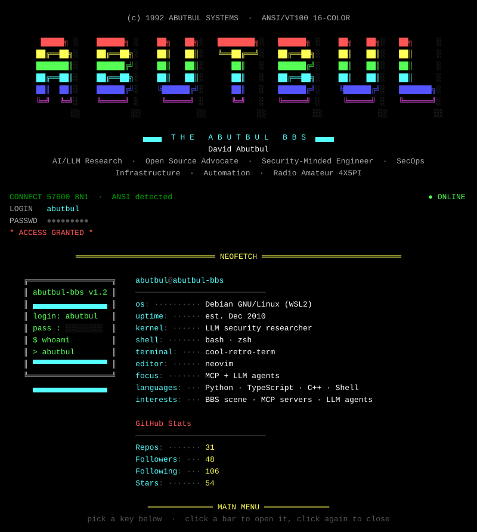</picture>

<picture></picture>

<picture>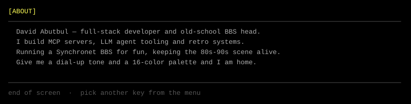</picture>

<picture></picture>

<picture>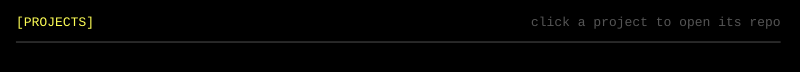</picture>
<a href="https://github.com/abutbul/openapi-mcp-generator">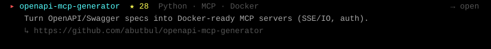</a>
<a href="https://github.com/abutbul/mod-game-state-api">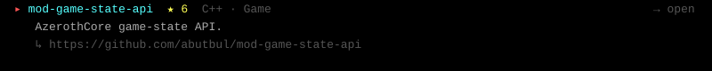</a>
<a href="https://github.com/abutbul/NoDrums">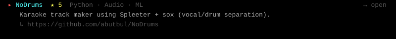</a>
<a href="https://github.com/abutbul/docker-knapsack-llm">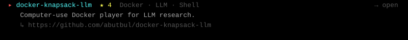</a>
<a href="https://github.com/abutbul/mcp-host">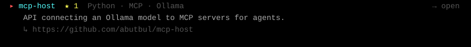</a>
<a href="https://github.com/abutbul/imgen">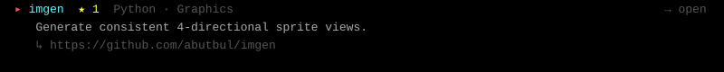</a>
<a href="https://github.com/abutbul/gizbar">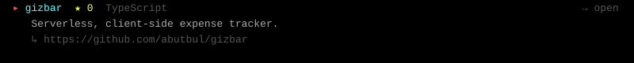</a>
<a href="https://github.com/abutbul/trbbs">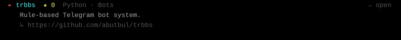</a>
<picture>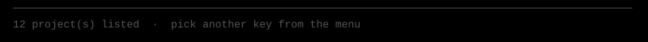</picture>

<picture>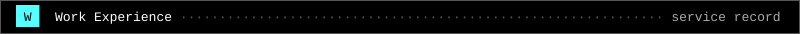</picture>

<picture>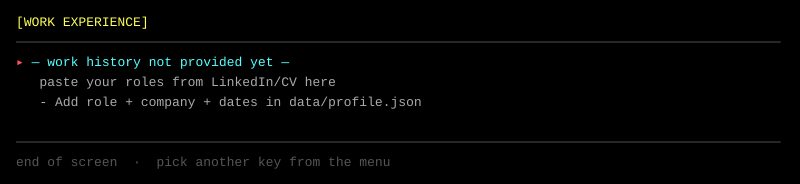</picture>

<picture></picture>

<picture>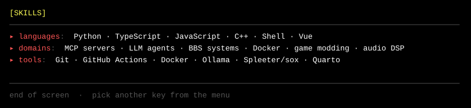</picture>

<picture></picture>

<picture>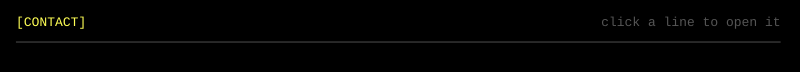</picture>
<a href="https://github.com/abutbul">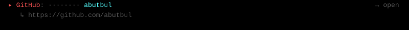</a>
<a href="https://abutbul.com">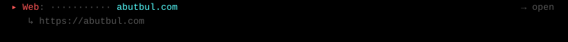</a>
<a href="https://news.ycombinator.com/user?id=abutbul">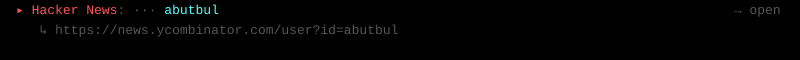</a>
<a href="mailto:you@example.com">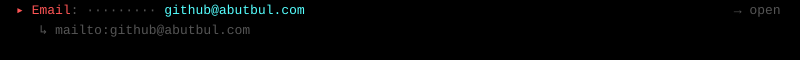</a>
<a href="https://www.linkedin.com/in/your-handle">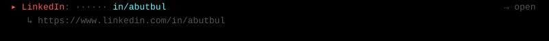</a>
<picture>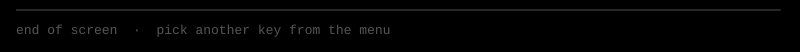</picture>

<picture></picture>

<picture>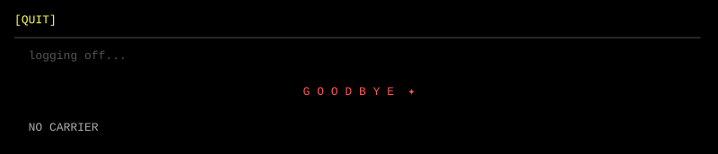</picture>
<a href="https://github.com/abutbul">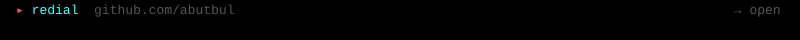</a>

<picture></picture>

plain-text mode (no ANSI)

<h3>David Abutbul</h3>

<i>Full-stack developer · BBS &amp; MCP enthusiast</i>

<ul>
<li>David Abutbul — full-stack developer and old-school BBS head.</li>
<li>I build MCP servers, LLM agent tooling and retro systems.</li>
<li>Running a Synchronet BBS for fun, keeping the 80s-90s scene alive.</li>
<li>Give me a dial-up tone and a 16-color palette and I am home.</li>
</ul>
<h4>Projects</h4>
<ul>
<li><a href="https://github.com/abutbul/openapi-mcp-generator"><b>openapi-mcp-generator</b></a> — Turn OpenAPI/Swagger specs into Docker-ready MCP servers (SSE/IO, auth). Python · MCP · Docker</li>
<li><a href="https://github.com/abutbul/mod-game-state-api"><b>mod-game-state-api</b></a> — AzerothCore game-state API. C++ · Game</li>
<li><a href="https://github.com/abutbul/NoDrums"><b>NoDrums</b></a> — Karaoke track maker using Spleeter + sox (vocal/drum separation). Python · Audio · ML</li>
<li><a href="https://github.com/abutbul/docker-knapsack-llm"><b>docker-knapsack-llm</b></a> — Computer-use Docker player for LLM research. Docker · LLM · Shell</li>
<li><a href="https://github.com/abutbul/mcp-host"><b>mcp-host</b></a> — API connecting an Ollama model to MCP servers for agents. Python · MCP · Ollama</li>
<li><a href="https://github.com/abutbul/imgen"><b>imgen</b></a> — Generate consistent 4-directional sprite views. Python · Graphics</li>
<li><a href="https://github.com/abutbul/gizbar"><b>gizbar</b></a> — Serverless, client-side expense tracker. TypeScript</li>
<li><a href="https://github.com/abutbul/trbbs"><b>trbbs</b></a> — Rule-based Telegram bot system. Python · Bots</li>
</ul>
<h4>Work Experience</h4>
<ul>
<li><b>— work history not provided yet —</b> — paste your roles from LinkedIn/CV here Add role + company + dates in data/profile.json</li>
</ul>
<h4>Skills</h4>
<ul>
<li><b>languages</b>: Python · TypeScript · JavaScript · C++ · Shell · Vue</li>
<li><b>domains</b>: MCP servers · LLM agents · BBS systems · Docker · game modding · audio DSP</li>
<li><b>tools</b>: Git · GitHub Actions · Docker · Ollama · Spleeter/sox · Quarto</li>
</ul>
<h4>Contact</h4>
<ul>
<li><b>GitHub</b>: <a href="https://github.com/abutbul">abutbul</a></li>
<li><b>Web</b>: <a href="https://abutbul.com">abutbul.com</a></li>
<li><b>Hacker News</b>: <a href="https://news.ycombinator.com/user?id=abutbul">abutbul</a></li>
<li><b>Email</b>: <a href="mailto:you@example.com">you@example.com</a></li>
<li><b>LinkedIn</b>: <a href="https://www.linkedin.com/in/your-handle">in/your-handle</a></li>
</ul>

repos 31 · followers 48 · following 106 · stars 54

ANSI · 80s–90s BBS scene (ACiD/iCE) · generated from code — <code>generator/generate.py</code> · <code>data/profile.json</code>

