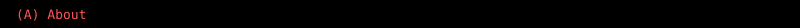
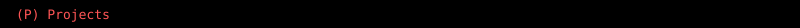

# probe

T1 picture in summary:

<picture></picture>

T1 body

T2 plain img in summary:

T2 body

T3 stacked linked images align=top:

T4 stacked linked images, no align:

T5 stacked picture images with br:

<picture></picture> <picture></picture>

T6 details name group:

one
body one

two
body two

T7 kbd: <kbd>A</kbd> About

T8 summary with picture full width, details inside p-less stack:

<picture></picture>
<picture></picture>

<picture></picture>
<picture></picture>

